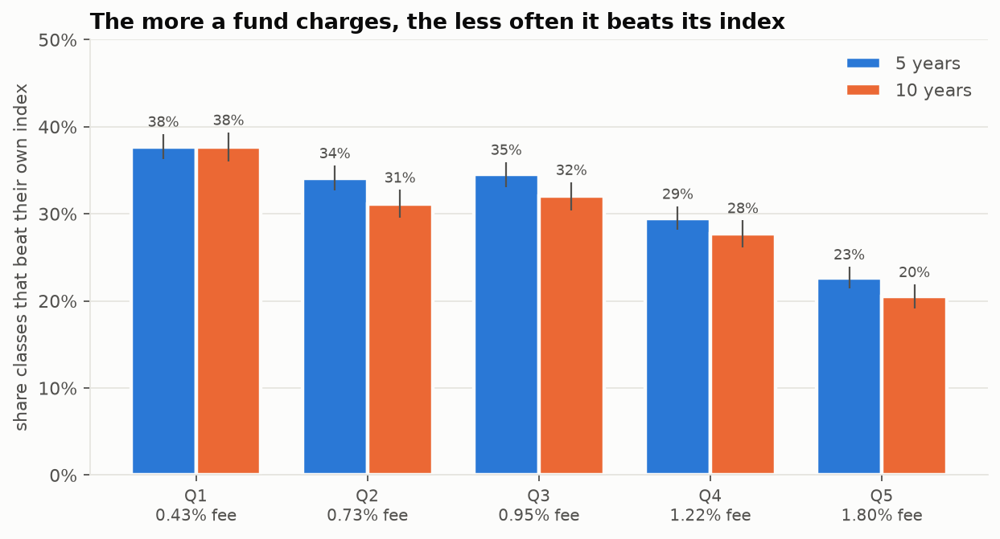
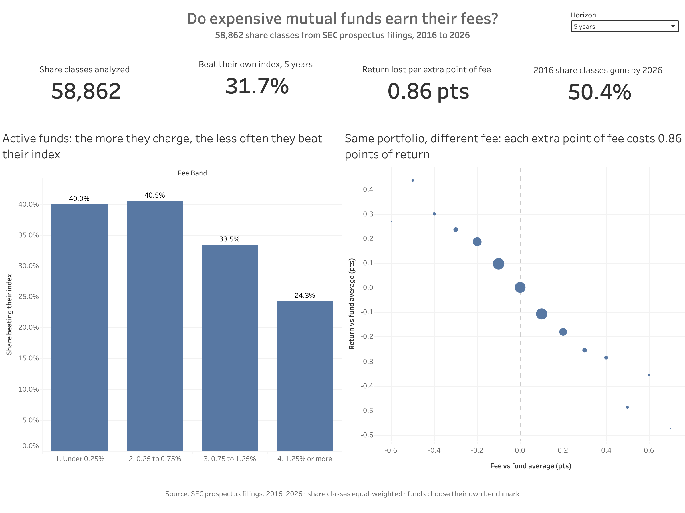
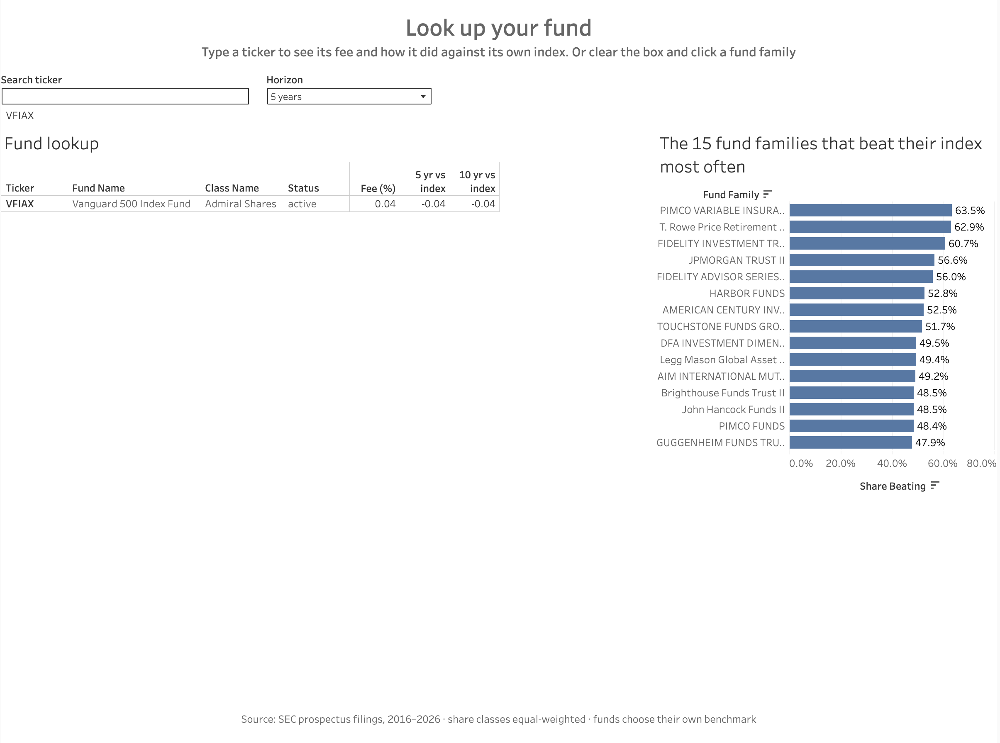
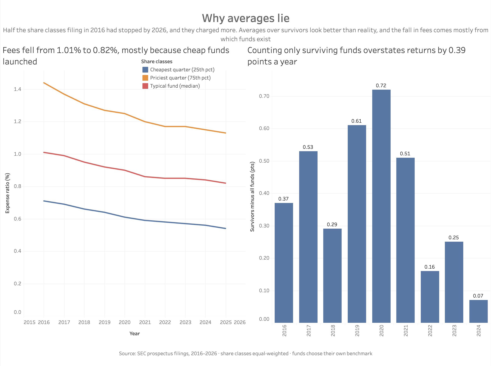

# Do Expensive Mutual Funds Earn Their Fees?

**An analysis of 58,862 mutual fund share classes from ten years of SEC prospectus
filings: what funds charge, whether the fee comes straight out of the return,
whether expensive funds beat their benchmark, and how much survivorship bias
flatters the averages.**


Every mutual fund prospectus opens with the same summary: a fee table, a bar
chart of yearly returns, and a comparison with a market index the fund picks
itself. The SEC publishes those numbers as structured data. This project turns
42 quarters of it (2016 to mid-2026) into a tested dbt warehouse and answers the
question every investor choosing a fund, and every analyst recommending one,
has to answer: is a higher fee worth paying?

## What it found

| Question | Answer |
|---|---|
| What do funds charge? | The median share class fell from **1.01%** (2016) to **0.82%** (2025). Most of that 0.19-point fall came from cheap funds launching and expensive ones closing: classes present in both years only fell from 0.93% to 0.87%. |
| Do fees come straight out of returns? | Yes. Share classes of the same fund hold the same portfolio; one charging a point more returned **0.86 points less** (95% interval 0.82 to 0.90). |
| Do expensive funds beat their index? | Less often. **31.7%** of share classes beat their own index over 5 years. The cheapest fifth did **37.7%** of the time, the most expensive fifth **22.7%**. The most expensive fifth charges 1.37 points more a year but earned only 0.12 points more before fees. |
| How much does survivorship flatter the averages? | **50.4%** of the share classes filing in 2016 had stopped by 2026, and they charged more. Averaging only survivors overstates yearly returns by **0.39 points**. |

Full results with every table: **[reports/FINDINGS.md](reports/FINDINGS.md)**.



## How it works

```
SEC quarterly zips (42 files, 1.3 GB)  +  SEC yearly fund lists (names, tickers)
      ↓  funds ingest     keep fee and return facts only → Parquet (7.5M facts, 33 MB)
      ↓  funds build      dbt: staging → intermediate → marts, 38 data tests
      ↓  funds analyze    Q1-Q4 → results.json, figures, Tableau tables, FINDINGS.md
```

The whole pipeline runs in about 11 seconds after download.

### The data engineering problem

The SEC changed its reporting vocabulary in 2024. Older filings use the `rr`
taxonomy, newer ones `oef`, and they encode the same facts differently:

| | `rr` (to 2025) | `oef` (from 2024) |
|---|---|---|
| Share class | its own column | inside a dimension string, `Class=C000038531;` |
| Yearly return | year in the tag name, `AnnualReturn2014` | year in the period date, `AnnlRtrPct` |
| Benchmark return | carries the fund's ID | carries no fund ID |
| 1, 5, 10 year averages | separate tags | one tag, periods not labeled |

dbt merges both into one star schema, with the rules from
[docs/DESIGN.md](docs/DESIGN.md) applied in SQL and checked by data tests:

| Layer | Models | Does |
|---|---|---|
| staging | `stg_facts`, `stg_submissions`, `stg_series_class` | typed, renamed, share class extracted from either format |
| intermediate | `int_expense_ratios`, `int_annual_returns`, `int_class_year_returns`, `int_benchmark_comparisons`, `int_class_series` | formats merged, restatements deduplicated, after-tax rows dropped, invalid values flagged |
| marts | `dim_fund`, `dim_share_class`, `fct_class_fees`, `fct_class_returns`, `fct_benchmark_excess` | the star schema the analysis and Tableau read |

### The analysis

| Question | Method |
|---|---|
| Q1. Fees | Median effective expense ratio (net of waivers) by prospectus year; the same classes followed across years to separate price cuts from changes in which funds exist |
| Q2. Fees and returns | Within-fund regression: each class's return and fee relative to its fund's average that year, standard errors clustered by fund |
| Q3. Benchmarks | 5 and 10 year returns against the one index each prospectus names, by fee quintile, with Wilson intervals |
| Q4. Survivorship | Yearly average return over every class against survivors only; fees and results of classes that stopped filing |

## Tech stack

| Layer | Tools |
|---|---|
| Ingestion | Python 3.13, SEC fair-access downloads, zip to Parquet |
| Warehouse | DuckDB, dbt-core with dbt-duckdb, 38 data tests |
| Analysis | polars, NumPy, SciPy, statsmodels (cluster-robust OLS, Wilson intervals) |
| Visualization | matplotlib (report figures), Tableau Public (dashboard) |
| Quality | pytest, ruff |

## Project structure

```
mutual-fund-fees-analysis/
├── src/funds/
│   ├── download.py        SEC files, with the required contact header
│   ├── ingest.py          zips and yearly fund lists to Parquet
│   ├── build.py           runs dbt build
│   ├── fees.py            Q1
│   ├── within_fund.py     Q2
│   ├── benchmark.py       Q3
│   ├── survivorship.py    Q4
│   ├── export.py          Tableau tables
│   ├── figures.py         report figures
│   ├── report.py          renders FINDINGS.md from results.json
│   ├── run.py             runs Q1-Q4
│   └── cli.py             `funds download | ingest | build | analyze | all`
├── dbt/
│   ├── models/staging/    3 models
│   ├── models/intermediate/  6 models
│   ├── models/marts/      5 models, the star schema
│   └── macros/            custom data tests
├── tests/                 synthetic data with known answers
├── docs/
│   ├── DESIGN.md          questions and rules, fixed before the analysis
│   ├── TABLEAU.md         dashboard build guide
│   └── screenshots/       the three dashboards
├── outputs/
│   ├── results.json       every number the project reports
│   ├── figures/
│   └── tableau/           funds_dashboard.xlsx (every table) and CSVs of the data tables
└── reports/FINDINGS.md    full results, generated
```

## Dashboard

**[Open the interactive dashboard on Tableau Public](https://public.tableau.com/app/profile/mayur.mahavir.bijarniya/viz/DoExpensiveMutualFundsEarnTheirFees/3_Whyaverageslie)**

Built from one workbook, `outputs/tableau/funds_dashboard.xlsx`, as three dashboards.

**1. Are fees worth paying?** Headline numbers, index-beating by fee band, and the
same-fund comparison. A 5/10 year switch changes the fee band chart.



**2. Look up your fund.** Type a ticker to see its fee and its 5 and 10 year result
against its own index. Clicking a fund family lists its share classes.



**3. Why averages lie.** How much of the fall in fees comes from which funds exist,
and how much counting only survivors flatters returns.



The row-level share class table lets Tableau do the work rather than display
precomputed numbers: fee bands, index-beating shares, the 5/10 year parameter, a
level-of-detail expression for each family's median fee, a rank filter for the top
families, and a filter action linking the family chart to the lookup. Build steps:
[docs/TABLEAU.md](docs/TABLEAU.md).

## Reproduce

```bash
python3.13 -m venv .venv && .venv/bin/python -m pip install -e ".[dev]"
.venv/bin/funds download --user-agent "Your Name your@email.com"
.venv/bin/funds all
.venv/bin/python -m pytest -q
```

The SEC requires a name and contact email on automated downloads and refuses
requests without them. The raw files (1.3 GB) are not committed; the outputs in
`outputs/` and `reports/` are, and tests fail if `FINDINGS.md` or the figures in
this README drift from `outputs/results.json`.

## Limits

- **Equal-weighted.** The filings carry no fund sizes, so figures are per share
  class, not per dollar invested.
- **Funds choose their benchmark**, which can flatter them.
- **Stopping filing is not always failure:** classes also merge, convert or are renamed.
- **One benchmark only:** funds listing several indexes on one date are left out of Q3.
- **Tickers as filed.** 13,791 share classes have no ticker in the SEC lists, and 81
  Nuveen Class T shares carry placeholder tickers (0001 to 0089); all 81 stopped filing.
- **Reproduce-and-extend, not new.** S&P's SPIVA reports and Morningstar have studied
  active funds against benchmarks and fees for years. This rebuilds the question
  from raw SEC filings, with a tested pipeline anyone can rerun.

## Sources

| Data | Source |
|---|---|
| Fees and returns | [SEC Mutual Fund Prospectus Risk/Return Summary Data Sets](https://www.sec.gov/data-research/sec-markets-data/mutual-fund-prospectus-riskreturn-summary-data-sets), [field documentation](https://www.sec.gov/dera/data/rr1.pdf) |
| Fund names and tickers | [SEC Investment Company Series and Class Information](https://www.sec.gov/data-research/sec-markets-data/investment-company-series-class-information) |

Both are US government works in the public domain. Downloaded 2026-10-22.
