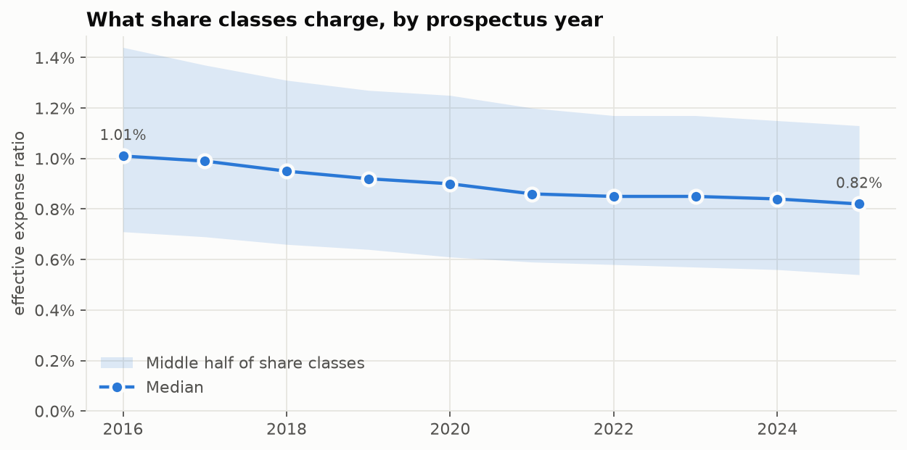
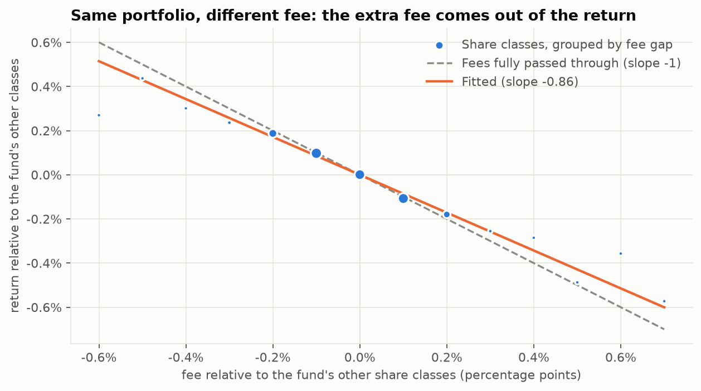
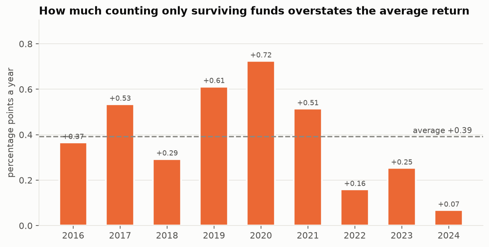

# Findings

Generated from `outputs/results.json` by `funds analyze`. Do not edit by hand:
re-run the pipeline instead.

**Data:** 42 quarterly SEC prospectus datasets, 2016q1 to
2026q2: 55,815 filings and 7,550,615 fee and return
facts, covering 58,862 share classes in 23,372 funds
(44,101 with a ticker). 3.7% of the
264,403 class-year returns differ between the prospectuses that restate
them; 349 of 473,119 expense ratios
were outside 0 to 10% and excluded.

## Q1. What funds charge

The median share class's effective expense ratio fell from 1.01% in
2016 to 0.82% in 2025.

Most of that 0.19-point fall came from **which funds exist**, not
from funds cutting their prices. The 19,208 share classes that filed in both
years went from a median of 0.93% to
0.87%, a fall of only 0.06 points; the
typical class changed its fee by -0.04 points.
67% cut their fee and 20% raised it.
The rest of the decline is cheaper funds launching and more expensive ones
closing: share classes that stopped filing had a median fee of
1.03%, against 0.82%
for those still filing.

## Q2. Fees come out of returns

Share classes of the same fund hold the same portfolio. Within a fund and year, a class
charging one percentage point more returned **0.86 points less**
(95% interval 0.82 to 0.90), across 54,854
class-years in 3,839 funds.

| Fee matched to the return | Slope [95% interval] | Class-years | Funds |
|---|---|---|---|
| next prospectus | -0.86 [-0.90, -0.82] | 54,854 | 3,839 |
| same year prospectus | -0.88 [-0.93, -0.84] | 46,686 | 3,322 |
| typical fee | -0.76 [-0.85, -0.68] | 107,580 | 3,936 |

The main specification takes the fee from the prospectus filed the following year,
which reports that year's actual expenses. A class's typical fee across all years is a
noisier measure of what it charged in a given year, which pulls the slope toward zero.
The remaining gap from -1 is consistent with the prospectus fee being a stated ratio
rather than the exact cost charged that year.

## Q3. Expensive funds beat their index less often

Each share class against the one index its own prospectus names, latest comparison per
class:

- **5 years:** 31.7% of 21,122 share classes
  beat their index (95% interval 31.1% to
  32.3%); median excess return -0.52
  points a year.
- **10 years:** 29.8% of 16,057; median excess
  return -0.48 points a year.

By fee quintile, 5 years:

| Fee quintile | Fee range | Share classes | Beat their index | Median excess | Median excess before fees |
|---|---|---|---|---|---|
| Q1 | 0.00% to 0.60% | 4,224 | 37.7% [36.3%, 39.2%] | -0.11 | +0.17 |
| Q2 | 0.60% to 0.84% | 4,224 | 34.1% [32.7%, 35.6%] | -0.46 | +0.25 |
| Q3 | 0.84% to 1.06% | 4,225 | 34.5% [33.1%, 36.0%] | -0.66 | +0.28 |
| Q4 | 1.06% to 1.45% | 4,224 | 29.5% [28.1%, 30.9%] | -0.98 | +0.25 |
| Q5 | 1.45% to 9.96% | 4,225 | 22.7% [21.4%, 23.9%] | -1.48 | +0.29 |

The cheapest fifth beat its index 37.7% of the time and the most
expensive fifth 22.7%. **Higher fees do not buy matching
results.** The most expensive fifth charges 1.37 points a year more than
the cheapest, but before fees it did only 0.12 points better over 5
years (0.32 better over 10, against a fee gap of
1.33). Most of the extra fee is a straight loss to the investor. On
average across share classes (a regression, so the highest fees weigh in more than in
the medians above), each extra point of fee went with
1.48 points less excess return a year (95% interval
1.30 to 1.65).

Index funds beat their index 10.1% of the time
(962 share classes), with a median excess return of
-0.26 points against a median fee of
0.30%: they track their index minus their cost, as designed.
Other funds beat theirs 32.7% of the time.

10 years:

| Fee quintile | Fee range | Share classes | Beat their index | Median excess | Median excess before fees |
|---|---|---|---|---|---|
| Q1 | 0.00% to 0.63% | 3,211 | 37.7% [36.0%, 39.4%] | -0.12 | +0.23 |
| Q2 | 0.63% to 0.85% | 3,211 | 31.1% [29.6%, 32.8%] | -0.42 | +0.31 |
| Q3 | 0.85% to 1.06% | 3,212 | 32.0% [30.4%, 33.6%] | -0.53 | +0.42 |
| Q4 | 1.06% to 1.45% | 3,211 | 27.7% [26.2%, 29.3%] | -0.75 | +0.47 |
| Q5 | 1.45% to 8.90% | 3,212 | 20.5% [19.1%, 21.9%] | -1.24 | +0.55 |

## Q4. Survivorship

Of the 36,891 share classes filing in 2016, 18,607
(50.4%) had stopped filing by the end of the data. They charged
more: a median of 1.10% against 0.88%
for the survivors.

Averaging only the classes that survived overstates the average yearly return by
**0.39 percentage points a year** (2016 to 2024). Over
5 years, 36.2% of surviving classes beat their index, against
24.7% of those that stopped filing.

## Limits

- **Equal-weighted.** The filings carry no fund sizes, so every figure is per share class,
  not per dollar invested. Large, cheap index funds hold most of the money.
- **The fund chooses its benchmark.** A fund may pick an index that flatters it.
- **Stopping filing is not always failure.** Classes also disappear when they merge,
  convert into another class or are renamed.
- **One benchmark only.** Funds listing two or more indexes on the same date are left out
  of Q3 rather than matched by guesswork.
- **2026 is partial.** Fee figures for 2026 cover filings to mid-year only.

## Sources

- [SEC Mutual Fund Prospectus Risk/Return Summary Data Sets](https://www.sec.gov/data-research/sec-markets-data/mutual-fund-prospectus-riskreturn-summary-data-sets)
- [SEC field documentation](https://www.sec.gov/dera/data/rr1.pdf)
- [SEC Investment Company Series and Class Information](https://www.sec.gov/data-research/sec-markets-data/investment-company-series-class-information)
